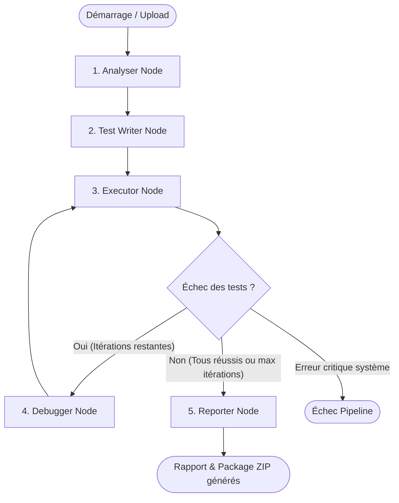

# AutoTest — AI-Powered Autonomous Python Testing & Quality Assurance Workspace

[](https://www.python.org/downloads/)
[](https://fastapi.tiangolo.com)
[](https://react.dev/)
[](https://github.com/langchain-ai/langgraph)
[](https://www.trychroma.com/)
[](LICENSE)
[]()

**AutoTest** is a state-of-the-art multi-agent testing and software quality platform designed for Python engineers. It autonomously analyzes Python source repositories, writes comprehensive `pytest` suites (happy path, edge cases, error cases), executes tests within an isolated sandbox or local runtime, iteratively diagnoses and repairs failures via an AST-safe self-healing loop, and generates industrial-grade quality and code-smell audit reports.

The platform includes a **100% French web interface** (React 18 + TypeScript + Vite + Tailwind CSS) providing live Server-Sent Events (SSE) pipeline tracking, syntax-highlighted code inspection, interactive source file filtering, project renaming, and instant test package downloads.

---

## Sommaire / Table of Contents

1. [Architecture & Workflow Multi-Agents](#architecture--workflow-multi-agents)
2. [Fonctionnalités Principales (Key Features)](#fonctionnalités-principales-key-features)
3. [Mémoire RAG de Patterns de Bugs (ChromaDB)](#mémoire-rag-de-patterns-de-bugs-chromadb)
4. [Gestion Avancée des Fichiers & Projets](#gestion-avancée-des-fichiers--projets)
5. [Interface Utilisateur (UI)](#interface-utilisateur-ui)
6. [Structure du Projet](#structure-du-projet)
7. [Stack Technique](#stack-technique)
8. [Prérequis & Installation](#prérequis--installation)
9. [Configuration (.env)](#configuration-env)
10. [Lancement de l'Application](#lancement-de-lapplication)
11. [Déploiement Docker](#déploiement-docker)
12. [Référence Complète de l'API REST](#référence-complète-de-lapi-rest)
13. [Suite de Tests Automatisés](#suite-de-tests-automatisés)
14. [Sécurité & Sandboxing](#sécurité--sandboxing)

---

## Architecture & Workflow Multi-Agents

AutoTest s'appuie sur un graphe d'états orchestré par **LangGraph** (`core/graph.py`). Le pipeline coordonne cinq agents d'ingénierie spécialisés :



### Rôles des 5 Agents Spécialisés

| Agent | Module | Description & Responsabilités |
| :--- | :--- | :--- |
| **Analyser** | `agents/analyser.py` | Analyse statique AST approfondie du code source. Identifie les fonctions, classes, dépendances, complexité cyclomatique (via Radon), et zones de risque élevé (divisions par zéro potentielles, accès non sécurisés, effets de bord). |
| **Test Writer** | `agents/test_writer.py` | Génère des suites de tests unitaires `pytest` robustes. Couvre trois dimensions : **Happy Path** (cas nominaux), **Edge Cases** (valeurs limites, types inattendus, chaînes vides), et **Error Cases** (exceptions attendues). Interroge la base RAG pour injecter des patterns de tests réutilisables. Valide la syntaxe par compilation AST avant écriture. |
| **Executor** | `agents/executor.py` | Exécute les tests générés avec calcul de couverture (`pytest-cov`). Prise en charge de deux modes d'exécution : bac à sable cloud sécurisé **E2B Sandbox** ou exécution isolée en sous-processus local. Extrait les sorties standard, erreurs et traces complètes. |
| **Debugger** | `agents/debugger.py` | Boucle autonome d'auto-réparation (*Self-Healing*). En cas d'échec de test, analyse la trace d'erreur (*Root Cause Analysis*), identifie si l'erreur provient du test ou du code source, génère un correctif ciblé et l'applique de façon sécurisée via validation AST. Stocke le correctif résolu dans la base RAG. |
| **Reporter** | `agents/reporter.py` | Audite l'ensemble de la session de test. Calcule un score global de qualité pondéré sur 100, répertorie les *Code Smells* avec niveau de criticité, évalue la maintenabilité et compile un rapport exécutif synthétique bilingue (JSON et Markdown). |

---

## Fonctionnalités Principales (Key Features)

- **Extraction Sécurisée d'Archives** :
  - Support des archives `.zip`, `.tar.gz`, `.tgz` et téléversement unitaire de fichiers `.py`.
  - Protection contre les attaques *Path Traversal* (`../`) et bombes de décompression (*Zip Bombs* avec limite configurable).
- **Gestion Flexible des Fichiers Sources** :
  - Visualisation et navigation dans l'arborescence des fichiers avec coloration syntaxique Python.
  - **Suppression unitaire** ou **par lot (batch)** des fichiers indésirables directement depuis l'espace de travail.
  - **Sélection / Filtrage granulaire** : cases à cocher permettant de cibler exactement les modules à analyser et persister sans supprimer le reste.
- **Génération Autonome de Tests `pytest`** :
  - Mocking automatique des dépendances externes ou manquantes pour garantir l'exécution immédiate.
  - Typage strict, docstrings explicites et assertions rigoureuses.
- **Boucle d'Auto-Guérison (Self-Healing Debugger)** :
  - Jusqu'à 3 itérations de réparation automatisée.
  - Remplacement regex résilient aux barres obliques inverses (`\`) et validation systématique de la conformité AST de tout code modifié.
- **Audit de Qualité & Détection de Code Smells** :
  - Calcul de complexité cyclomatique par fonction (Radon).
  - Détection des codes smells (fonctions trop longues, imbrications excessives, arguments surnuméraires, exceptions génériques attrapées).
- **Streaming Temps-Réel (SSE)** :
  - Suivi en direct étape par étape du déroulement du pipeline via Server-Sent Events (`/v1/runs/{run_id}/stream`).
- **Export & Téléchargements** :
  - Téléchargement des suites de tests au format ZIP.
  - Exportation du package complet de session (code source, tests générés, rapports, métriques de couverture).
  - Rapports de synthèse en Markdown et JSON.

---

## Mémoire RAG de Patterns de Bugs (ChromaDB)

AutoTest intègre un système de **RAG (Retrieval-Augmented Generation)** propulsé par **ChromaDB** (`chroma_data/`) pour accumuler des connaissances sur les tests et les correctifs :

1. **Indexation** : Lorsqu'un test est validé ou lorsqu'un bug est réparé avec succès par le Debugger, le motif de correction, la trace d'erreur et la structure du test sont vectorisés et enregistrés dans la collection `bug_patterns`.
2. **Recherche contextuelle** : Lors de la génération de nouveaux tests pour une fonction, le Test Writer interroge ChromaDB pour retrouver les 3 modèles de tests les plus similaires afin de reproduire les meilleures pratiques éprouvées.

---

## Gestion Avancée des Fichiers & Projets

L'application permet aux ingénieurs d'administrer leurs projets en toute autonomie :
- **Renommage dynamique** : Modifier le nom d'un projet à tout moment depuis l'interface avec sauvegarde instantanée dans `metadata.json`.
- **Suppression définitive de fichiers** :
  - Endpoint REST dédié : `DELETE /api/projects/{project_id}/source/{file_path:path}`
  - Suppression par lot : `POST /api/projects/{project_id}/source/delete-batch`
  - Les compteurs de fichiers et métadonnées sont synchronisés immédiatement sur disque.
- **Sélection ciblée pour l'analyse** :
  - L'ingénieur peut cocher/décocher des fichiers dans l'interface.
  - Le déclenchement de l'analyse (`POST /v1/projects/{project_id}/analyze`) transmet `{ "source_files": ["module1.py", "module2.py"] }`, exécutant le pipeline uniquement sur les modules souhaités.

---

## Interface Utilisateur (UI)

L'interface web est une Single Page Application (SPA) moderne, réactive et bilingue, conçue avec **React 18**, **TypeScript**, **Tailwind CSS**, et **Lucide Icons** :

| Page | Route | Description |
| :--- | :--- | :--- |
| **Tableau de Bord** | `/` | Vue d'ensemble du workspace, statistiques agrégées (nombre de projets, sessions, scores moyens), téléversement direct d'archives. |
| **Projets** | `/projects` | Liste complète des projets avec recherche, compteurs de fichiers, dates d'ajout et sessions associées. |
| **Détail du Projet** | `/projects/:projectId` | Explorateur de fichiers sources, visualiseur de code, cases à cocher d'inclusion, suppression de fichiers et historique des runs. |
| **Progression en Direct** | `/runs/:runId/progress` | Suivi animé en temps réel de l'exécution des nœuds du graphe LangGraph via flux SSE. |
| **Résultats de Session** | `/runs/:runId/results` | Synthèse exécutive : score de qualité /100, indicateurs de succès, couverture de code globale et alertes. |
| **Tests Générés** | `/runs/:runId/tests` | Explorateur de code des tests `pytest` produits, avec bouton de téléchargement ZIP. |
| **Débogueur** | `/runs/:runId/debugger` | Journal des réparations autonomes : causes profondes identifiées, correctifs appliqués et itérations. |
| **Qualité & Code Smells** | `/runs/:runId/quality` | Détail des complexités cyclomatiques (Radon) et analyse des anti-patterns. |
| **Rapport d'Audit** | `/runs/:runId/report` | Rapport technique complet prêt pour l'exportation et la documentation d'ingénierie. |

---

## Structure du Projet

```text
multi_agent_testing/
├── agents/                       # Les 5 nœuds du pipeline multi-agents
│   ├── analyser.py               # Analyse statique AST, complexité Radon & risques
│   ├── test_writer.py            # Synthèse des tests pytest & intégration RAG
│   ├── executor.py               # Exécution sandbox E2B ou locale & couverture
│   ├── debugger.py               # Boucle d'auto-réparation AST-safe
│   └── reporter.py               # Évaluation de la qualité, scores & synthèse
├── api/                          # Backend FastAPI
│   ├── main.py                   # Serveur FastAPI, routes v1, SSE stream & SPA static mount
│   └── routes/
│       └── projects.py           # Routes /api pour la gestion des projets et fichiers
├── core/                         # Orchestration du workflow
│   ├── graph.py                  # Graphe d'états LangGraph (nœuds et arêtes conditionnelles)
│   └── state.py                  # TypedDict AgentState partagé entre les agents
├── frontend/                     # Interface Web React + TypeScript + Vite
│   ├── src/
│   │   ├── components/           # Composants réutilisables (Layout, CodeViewer, Badges, etc.)
│   │   ├── pages/                # Les 9 pages de l'application
│   │   ├── services/api.ts       # Client API Axios & typages TypeScript
│   │   └── types/                # Définitions des structures de données
│   ├── dist/                     # Build de production compilé (servi par FastAPI)
│   └── package.json
├── llm/                          # Client LLM et connecteurs d'inférence
│   └── service.py                # Wrapper unifié pour OpenRouter / Groq / OpenAI API
├── tests/                        # Suite complète de tests automatisés (107 tests)
│   ├── test_api_security.py      # Tests de sécurité des archives & uploads
│   ├── test_debugger.py          # Tests de la boucle de self-healing
│   ├── test_executor.py          # Tests d'exécution et calcul de couverture
│   ├── test_project_files_management.py # Tests de gestion des fichiers sources
│   ├── test_rag.py               # Tests de la mémoire vectorielle ChromaDB
│   └── test_reporter.py          # Tests des métriques et rapports de qualité
├── workspace/                    # Dossier de travail (projets, sources et runs)
├── chroma_data/                  # Base de données vectorielle persistante ChromaDB
├── config.py                     # Configuration centralisée & validation typée
├── Dockerfile                    # Image Docker multi-stage (Node builder + Python runtime)
├── docker-compose.yml            # Déploiement conteneurisé
├── pytest.ini                    # Configuration de la suite de tests
└── requirements.txt              # Dépendances Python
```

---

## Stack Technique

- **Langage Backend** : Python 3.11+
- **Orchestration Multi-Agents** : [LangGraph](https://github.com/langchain-ai/langgraph) (`StateGraph`)
- **API Web & Serveur ASGI** : [FastAPI](https://fastapi.tiangolo.com/) & [Uvicorn](https://www.uvicorn.org/)
- **Frontend** : [React 18](https://react.dev/), [TypeScript](https://www.typescriptlang.org/), [Vite](https://vitejs.dev/), [Tailwind CSS](https://tailwindcss.com/)
- **Base de Données Vectorielle (RAG)** : [ChromaDB](https://www.trychroma.com/)
- **Moteur d'Exécution & Couverture** : `pytest`, `pytest-cov`, `coverage`
- **Analyse Statique de Code** : Python AST standard, `radon`, `networkx`
- **Fournisseur LLM** : [OpenRouter](https://openrouter.ai/) (compatible OpenAI API) avec modèles gratuits ou premium :
  - *Test Writer* : `cohere/north-mini-code:free` ou `qwen/qwen3.8-27b`
  - *Debugger* : `nvidia/nemotron-3-super-120b-a12b:free` ou `openai/gpt-oss-120b`
- **Sandbox d'Exécution (Optionnel)** : [E2B Code Interpreter](https://e2b.dev/)

---

## Prérequis & Installation

### 1. Prérequis Système
- **Python** : Version 3.11 ou supérieure installée
- **Node.js** : Version 18+ ou 20+ (nécessaire uniquement pour compiler le frontend)
- **Git**

### 2. Cloner le Dépôt
```bash
git clone https://github.com/votre-compte/AutoTest.git
cd AutoTest/multi_agent_testing
```

### 3. Environnement Virtuel Python
Sous Windows (PowerShell) :
```powershell
python -m venv venv
.\venv\Scripts\Activate.ps1
pip install --upgrade pip
pip install -r requirements.txt
```

Sous Linux / macOS (Bash) :
```bash
python3 -m venv venv
source venv/bin/activate
pip install --upgrade pip
pip install -r requirements.txt
```

### 4. Compiler le Frontend (SPA)
Le backend FastAPI sert automatiquement les fichiers statiques compilés depuis `frontend/dist/` :
```bash
cd frontend
npm install
npm run build
cd ..
```

---

## Configuration (.env)

Copiez le modèle d'environnement `.env.example` vers `.env` :

```bash
cp .env.example .env
```

Éditez le fichier `.env` avec vos paramètres :

```ini
# =============================================================================
# OBLIGATOIRE — Fournisseur LLM (OpenRouter)
# =============================================================================
OPENROUTER_API_KEY=sk-or-v1-votre-cle-api-ici
OPENROUTER_BASE_URL=https://openrouter.ai/api/v1

# Modèles attribués à chaque agent (modèles gratuits performants par défaut)
OPENROUTER_TEST_WRITER_MODEL=cohere/north-mini-code:free
OPENROUTER_DEBUGGER_MODEL=nvidia/nemotron-3-super-120b-a12b:free

# =============================================================================
# OPTIONNEL — Bac à sable E2B (recommandé pour code externe)
# =============================================================================
# Si non renseigné, l'exécution s'effectue en local en sous-processus sécurisé
# E2B_API_KEY=e2b_votre-cle-ici

# =============================================================================
# OPTIONNEL — Observabilité LangSmith
# =============================================================================
# LANGSMITH_API_KEY=lsv2_pt_votre-cle-ici
# LANGSMITH_PROJECT=autotest
# LANGSMITH_TRACING=true

# =============================================================================
# PARAMÈTRES SYSTÈME
# =============================================================================
MAX_UPLOAD_SIZE_MB=100
LOG_LEVEL=INFO
CHROMA_PERSIST_DIR=./chroma_data
```

---

## Lancement de l'Application

### Mode Production (Recommandé)
Le serveur FastAPI démarre et sert à la fois les routes de l'API REST et l'interface Web compilée :

```bash
# Activation de l'environnement virtuel
.\venv\Scripts\Activate.ps1    # ou source venv/bin/activate

# Démarrage du serveur Uvicorn
uvicorn api.main:app --host 0.0.0.0 --port 8000
```

Accédez à l'application :
- **Interface Web (UI)** : [http://localhost:8000/](http://localhost:8000/)
- **Documentation OpenAPI (Swagger)** : [http://localhost:8000/docs](http://localhost:8000/docs)
- **Documentation ReDoc** : [http://localhost:8000/redoc](http://localhost:8000/redoc)

### Mode Développement (Hot-Reloading Frontend)
Pour modifier le code frontend en direct avec rechargement à chaud :
```bash
# Terminal 1 : Backend API
uvicorn api.main:app --port 8000 --reload

# Terminal 2 : Frontend Vite Dev Server
cd frontend
npm run dev
```
L'interface de dev sera accessible sur [http://localhost:5173/](http://localhost:5173/) et redirigera automatiquement ses appels API vers le port 8000.

---

## Déploiement Docker

AutoTest fournit une configuration Docker multi-stage intégrant la compilation Node.js et l'exécution Python :

```bash
# Construction et lancement du conteneur
docker compose up -d --build
```

Pour visualiser les journaux d'exécution du conteneur :
```bash
docker compose logs -f
```

Pour arrêter le service :
```bash
docker compose down
```

---

## Référence Complète de l'API REST

### 1. Gestion des Projets (`/v1/projects` & `/api/projects`)

| Méthode | Point de Terminaison | Description |
| :--- | :--- | :--- |
| `POST` | `/v1/projects/upload` | Téléversement d'un projet (fichiers `.py` individuels ou archive `.zip` / `.tar.gz`). |
| `GET` | `/api/projects` | Liste tous les projets présents dans l'espace de travail avec leurs métadonnées. |
| `GET` | `/api/projects/{id}` | Détails complets d'un projet et liste de ses sessions de tests. |
| `DELETE` | `/api/projects/{id}` | Supprime définitivement un projet et tous ses runs associés. |
| `PATCH` | `/api/projects/{id}` | Renomme un projet existant et persiste le nom dans `metadata.json`. |
| `GET` | `/api/projects/{id}/source` | Liste tous les fichiers `.py` du projet avec leurs chemins relatifs et tailles. |
| `GET` | `/api/projects/{id}/source/{file_path}` | Récupère le contenu textuel complet d'un fichier source. |
| `DELETE` | `/api/projects/{id}/source/{file_path}` | Supprime définitivement un fichier source du projet avec recalcul automatique des métadonnées. |
| `POST` | `/api/projects/{id}/source/delete-batch` | Supprime un ensemble de fichiers sources spécifiés en lot (`{ "files": [...] }`). |

### 2. Exécution du Pipeline & Sessions (`/v1/projects` & `/v1/runs`)

| Méthode | Point de Terminaison | Description |
| :--- | :--- | :--- |
| `POST` | `/v1/projects/{id}/analyze` | Déclenche le pipeline multi-agents. Corps optionnel : `{ "source_files": ["f1.py", ...] }`. |
| `GET` | `/v1/runs/{run_id}` | Consulte le statut en direct de la session (`queued`, `running`, `completed`, `failed`). |
| `GET` | `/v1/runs/{run_id}/stream` | Flux SSE (*Server-Sent Events*) diffusant en direct l'avancement agent par agent. |
| `GET` | `/v1/runs/{run_id}/report` | Récupère le rapport complet d'audit de qualité (JSON par défaut, ou Markdown avec `?format=markdown`). |
| `GET` | `/v1/runs/{run_id}/tests` | Liste des fichiers de tests générés par l'agent Test Writer. |
| `GET` | `/v1/runs/{run_id}/tests/{filename}` | Contenu de code source d'un fichier de test généré. |
| `GET` | `/v1/runs/{run_id}/tests/download` | Télécharge l'ensemble des tests générés sous forme d'archive ZIP. |
| `GET` | `/v1/runs/{run_id}/package` | Télécharge l'archive complète de résultats (sources, tests, rapports et logs). |

### 3. Statistiques & Santé Système

| Méthode | Point de Terminaison | Description |
| :--- | :--- | :--- |
| `GET` | `/health` | Vérifie la disponibilité du serveur et les modèles LLM configurés. |
| `GET` | `/api/stats` | Métriques globales du workspace (projets, runs, score de qualité moyen, taux de succès). |
| `GET` | `/api/runs` | Liste globale des sessions de tests, filtrable par `?project_id=...`. |

---

## Suite de Tests Automatisés

AutoTest intègre une suite de tests unitaires et de sécurité complète (107 tests) couvrant tous les modules clés :

```bash
# Exécution de l'ensemble des tests unitaires
pytest

# Exécution avec rapport détaillé et mesure de couverture
pytest -v --cov=agents --cov=api --cov=core
```

### Détail de la Couverture de Test

```text
============================= test session starts =============================
collected 107 items

tests/test_api_security.py .........................                    [ 23%]
tests/test_project_files_management.py .....                            [ 28%]
tests/test_debugger.py ...........................                      [ 53%]
tests/test_executor.py .........................                        [ 76%]
tests/test_rag.py .....................                                 [ 95%]
tests/test_reporter.py ....................                             [100%]

============================= 107 passed in 36.62s =============================
```

---

## Sécurité & Sandboxing

1. **Isolation de l'Exécution du Code** :
   - Par défaut, si la clé `E2B_API_KEY` est configurée, les tests sont exécutés dans un bac à sable conteneurisé éphémère et étanche fourni par **E2B**.
   - En mode local, l'exécution s'opère dans des processus enfants contrôlés avec des timeouts stricts (`TEST_EXECUTION_TIMEOUT = 180s`) pour prévenir les boucles infinies ou les blocages.
2. **Validation Strict des Chemins (*Path Traversal Protection*)** :
   - Tous les chemins de fichiers d'archives ou de requêtes API sont résolus canoniquement (`Path.resolve()`) et validés pour garantir qu'ils ne sortent jamais du répertoire source du projet.
3. **Protection contre les *Zip Bombs*** :
   - Vérification de la taille totale décompressée et du ratio de compression lors de l'extraction des archives avec rejet immédiat en cas d'anomalie.
4. **Validation AST des Correctifs** :
   - Tout correctif généré par le Débogueur passe par `ast.parse()` avant d'être écrit sur disque. Si un correctif est syntaxiquement invalide, il est immédiatement rejeté pour empêcher toute corruption du code source.

---

## Licence

Ce projet est distribué sous la licence **MIT**. Vous êtes libre de l'utiliser, l'adapter et le distribuer dans vos projets personnels et professionnels.
